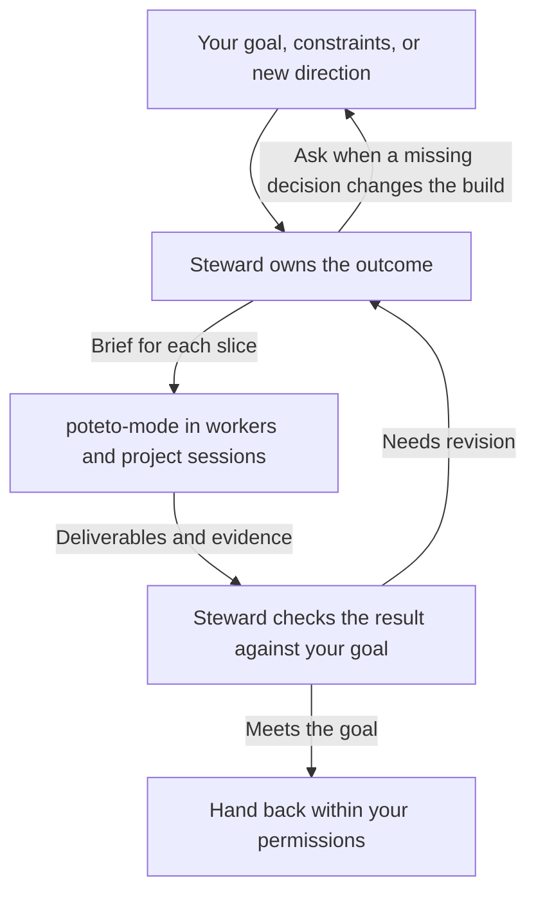

# Work above `/poteto-mode` with `/steward`

[`/poteto-mode`](./02-poteto-mode.md) is pstack's core execution engine. Give it a bounded
engineering task, and it picks a playbook, applies the engineering principles, and verifies
the result against the real artifact. Every [`poteto-worker`](../../agents/poteto-worker.agent.md)
runs that same contract on its delegated slice.

Clean code can pass every test and still solve the wrong problem. Once `poteto-mode` makes
individual slices reliable, [`/steward`](../../skills/steward/SKILL.md) provides the highest
layer of value above it. You hand Steward an intended outcome, and Steward researches missing
context, checks available tools, and directs its own team of `poteto-worker` subagents and
`poteto-mode` project sessions across repository and non-repository deliverables. That can
mean code and tests in a worktree alongside a design, document, script, or media file outside it.

## Choose the right layer

| | `/poteto-mode` | `/steward` |
| --- | --- | --- |
| What you bring | A bounded task with a result you can check. | An outcome that may need more discovery, several slices, or different deliverables. |
| What the session owns | The engineering task and its playbook. | The intended outcome and the team that produces the deliverables. |
| What you get back | A fix, feature, refactor, or investigation with evidence. | A checked set of deliverables, in or outside a repository. |
| What it checks | The actual behavior or artifact for that task. | The fit with your goal and the quality of the combined result. It also calls for independent checks. |
| How you switch | Enter with `/poteto-mode`. Stand it down with `skip poteto mode`. | Enter with `/steward`. Switch to `/poteto-mode` or stand Steward down with `skip steward`. |

## How Steward works



Steward keeps `<session_dir>/files/overview.md` outside the worktree. It records the intended
outcome, known facts, open gaps, current slices, and evidence or limits. When the host
offers `open_canvas`, Steward uses it to refresh the view.

The next four responsibilities stay active throughout the run. If new evidence changes the
goal during verification, Steward revisits the outcome and updates the worker briefs. It
tracks concrete slices and open questions in a todo list rather than using the
responsibilities as phases.

### Outcome

Steward keeps your words and decisions verbatim. It labels its own inferences and proposed
scope changes. It checks the result against the experience you want, who it's for, and what
you ruled out. When your direction or the evidence changes, Steward keeps only the work
that still fits. Time spent on earlier code or drafts does not justify keeping them.

### Context and capability

For repository work, Steward traces what the code does now. For open work, it checks the
domain, product details, references, and the public work of any creators you name. It
checks shell tools as well as host tools such as the browser, `image_generation`, and
available MCP servers.

If a missing reference, conflicting fact, or tool limit would change the build, format,
or quality you can get, Steward finishes discovery before it starts production. It updates
`overview.md` and presents its findings and the options the tools support. It recommends a
path before assigning work.

### Production commitments

Steward keeps research, option comparisons, `overview.md`, slice briefs, and output
inspection in its own session. It can generate host-only assets for workers, make one-line
polish edits, and carry out authorized git steps. Workers create and revise deliverables.
Steward does not invoke `poteto-mode` or `figure-it-out` in its own session.

- For dependent work, Steward starts fresh `poteto-worker` slices one at a time. When `task`
  exposes `mode`, it uses `mode: "sync"` for these slices. Fresh slices share files on disk
  rather than waiting on `write_agent`, which can time out on non-interactive hosts.
  If an approach might fail or fall short of the quality bar, Steward runs a short
  synchronous proof sample and inspects the output before the full build.
- For independent slices with separate owners and no shared writes, Steward starts workers
  in one parallel wave. It uses `mode: "background"` when `task` supports it. Steward waits
  for the completion notices before calling `read_agent`.
- From a chat without a repository, Steward uses `create_session` when a worker needs
  repository access or its own branch or PR. It starts a `poteto-mode` project session
  with `coordinate_with_creator: true` and `notify_on_idle: "always"`. It sends briefs with
  `send_session_message` and inspects changes with `get_changes_overview`. Standalone
  deliverables can go to `poteto-worker` without a repository session.

Before each managed delegate or session kickoff, Steward invokes
[context routing](../../skills/context-routing/SKILL.md). It copies the resolver's literal
launch arguments and `PSTACK_CONTEXT_V1` declaration. Worker slices use the role that fits
the work, such as `feature, refactoring`, `bug-fix`, `perf-issue`, `hillclimb`, or
`hardest tasks`. Read-only scouts and non-repository judgment or prose passes use
`how explorer` or `judgment and prose`. Their briefs forbid file writes, `poteto-mode`,
playbooks, and nested subagents.

### Confidence

Steward exercises user-visible behavior and inspects the deliverables itself. It runs the
flow, opens the PDF, or compares the exported data with the expected output. It separates
what it verified from worker reports and gaps in the evidence.

When `create_session` is available, Steward attaches [Double](../../skills/double/SKILL.md)
if you request supervision or leave a long run unattended. Double uses the `double verifier`
role. It checks factual claims and edits to tests or comparators against repository state
and session artifacts. It contacts the worker only when evidence refutes a claim. Double
neither writes code nor prescribes fixes.

Before returning multi-file or multi-step work, Steward also runs a single-pass, read-only
`general-purpose` rework critic. The critic uses `arena cross-judge pool`. Steward prefers
a model vendor family different from both Steward and the worker, then one different from
the worker, then `--member 0`.

Steward asks the critic what would make you send the result back. It shares your words
verbatim, `overview.md`, and the deliverables with inspection evidence. For repository
work, Steward includes the cumulative merge-base diff, `git status --short`, and untracked
files. Workers address findings that affect the result. If the deliverables change afterward,
Steward reruns the critic.

## Examples

### Start a new build at the Steward layer

Start a session from the terminal:

```bash
copilot --agent steward
```

If you installed the `pstack` wrapper from the [setup guide](./01-setup.md), you can use it instead:

```bash
pstack --agent steward
```

In an existing chat, enter Steward with:

```text
/steward
```

Then describe what the user needs to do, what stays out of scope, and how you'll check the result:

```text
Own the first version of CSV export. A support lead should be able to export one week's tickets without reading a manual.
Keep billing and permissions unchanged. Show the flow with a sample account and check the downloaded rows.
Leave the result in a local worktree for review.
```

Steward checks the app's current behavior, then assigns the work needed for the flow and its verification.

### Shape an outcome in chat, then hand it off

Start without a repository. Talk through who needs the work, what they need to do, and what you won't build. Once you're ready to hand it over, name the Copilot project and the deliverable that stays outside it:

```text
/steward take it on from here. Use our discussion as the brief for the Support Dashboard project.
Build saved filters in the dashboard and write a one-page training guide outside the repo.
Show me that a saved filter survives reload. Give me the guide as a separate file. Don't publish either.
```

Steward briefs a `poteto-mode` project session for the dashboard. It can assign the guide to a `poteto-worker` without another repository session. Steward checks both against the workflow you agreed on.

### Check alignment without editing files

Switch to Steward in an engineering session if you need to compare the work to the original goal:

```text
/steward review our chat against my goal. Check the current changes and what they actually prove.
Show what meets the goal, what to drop, and what still needs building. Don't edit files or start implementation.
```

Steward checks the work and proposes a revised roadmap. When that roadmap matches what you want, tell Steward to carry it out:

```text
good, complete this in steward
```

### Change direction mid-run

Describe the new audience or result rather than managing the workers:

```text
Managers need to print the weekly report for their meeting. Replace the interactive chart with a one-page PDF.
Keep the verified totals. Show me the PDF for the same sample input before you build the rest.
```

Steward updates the overview and briefs fresh slices. The time spent on the chart doesn't count toward keeping it. Steward keeps the verified totals because they still meet the goal.

### Leave a long build with independent checks

Give Steward a finish condition, an evidence request, and a stopping point:

```text
/steward I'm stepping away. Migrate all reports to the shared CSV formatter and update the support guide.
Done means no old formatter callers and sample exports match the expected headers, rows, and order.
Attach Double. Before handback, run the rework critic against the full diff and the updated guide.
Keep the changes local for review. Stop and report if matching the sample exports requires a format change.
```

Steward can prove one report first, then run independent report slices in parallel once the shared formatter is ready. Double audits claims during the run. Before handback, the critic checks whether the migration and guide meet the agreed outcome.

## Switch layers cleanly

Steward stays active across follow-ups such as `continue` or a status check. To switch to direct engineering, send:

```text
/poteto-mode
```

To stand Steward down for the session, send either command on its own:

```text
skip steward
```

```text
skip steward mode
```

Both stand-down commands also opt out of managed context routing. Native hooks save the opt-out across resumes when enabled. Send `/steward` or `/poteto-mode` on its own to re-enter managed routing.

## Pitfalls

- Describe who the work is for and what they should be able to do. Don't assign workers and models unless you need to override a default.
- Don't ask Steward to guess at a missing product fact. If the tools can't produce the medium you requested, decide whether a proposed alternative meets the goal. Permission to proceed doesn't authorize a quiet downgrade.
- Don't treat a passing sample as the finished deliverable or a silent Double session as approval. Ask Steward to show the final output and say what it checked.
- Name your publishing boundary. Steward does not merge, deploy, publish externally, or push to `main` without an explicit instruction in the current turn.

Back to the [guide index](./README.md).
